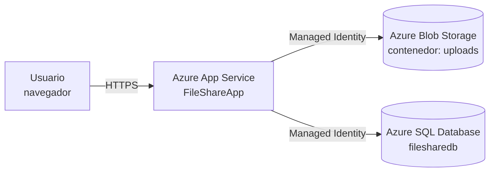

# FileShare – Programación Web 3 (UNLaM)

Aplicación web para compartir archivos, desarrollada en **.NET 10 (ASP.NET Core MVC)** y desplegada en **Microsoft Azure**. 
Es el proyecto práctico del trabajo de investigación de la materia Programación Web 3 de la Tecnicatura en Desarrollo Web (UNLaM).

La app permite registrarse, iniciar sesión, subir archivos (hasta 50 MB), ver todos los archivos subidos, descargarlos y eliminar los propios. 
Su objetivo es demostrar el uso de servicios de Azure desde .NET con autenticación sin claves (Microsoft Entra ID e identidades administradas).

**Tema de investigación: AZURE CLOUD COMPUTING** 

---

##  Funcionalidades:
	- Registro e inicio de sesión de usuarios (ASP.NET Core Identity).
	- Subida de archivos de hasta 50 MB.
	- Listado de archivos compartidos con nombre, tamaño, usuario que lo subió y fecha (UTC).
	- Descarga de cualquier archivo por parte de los usuarios autenticados.
	- Eliminación de archivos solo por quien los subió.
	- Contenido almacenado en Azure Blob Storage y metadatos en Azure SQL.
Si falla el guardado de los metadatos, el blob subido se elimina para no dejar archivos huérfanos.

---

## Tecnologías
| Capa | Tecnología |
|---|---|
| Framework | .NET 10, ASP.NET Core MVC |
| Autenticación de usuarios | ASP.NET Core Identity (cookies) |
| Acceso a datos | Entity Framework Core 10 + SQL Server |
| Almacenamiento de archivos | `Azure.Storage.Blobs` |
| Identidad hacia Azure | `Azure.Identity` |
| Interfaz | Bootstrap 5.3 |
 
---

## Arquitectura



### Servicios de Azure utilizados
 
| Servicio | Recurso | Para qué se usa |
|---|---|---|
| Azure App Service | `app-proyectopw3-4821` | Hospeda la aplicación web |
| Azure Blob Storage | `stproyectopw3` (contenedor `uploads`) | Guarda el contenido de los archivos |
| Azure SQL Database | `sql-proyectopw3-4820` / `filesharedb` | Guarda usuarios (Identity) y metadatos de archivos |
| Microsoft Entra ID | Tenant UNLaM | Autenticación de la app hacia Storage y SQL |
 
Todos los recursos están en el grupo de recursos `rg-fileshare`.

### Flujo de subida
 
	1. El usuario envía el archivo desde el formulario.
	2. La app genera un nombre único (GUID) y sube el contenido a **Blob Storage**.
	3. La app guarda en **Azure SQL** el nombre original, el nombre del blob, el tipo, el tamaño, el usuario y la fecha.
	4. Si el paso 3 falla, se elimina el blob del paso 2.

### Autenticación sin claves
 
La app **no usa contraseñas ni cadenas de conexión con claves** para hablar con Azure. En su lugar, Azure verifica la **identidad** de quien hace la petición y comprueba si tiene permisos sobre el recurso:
 
| Entorno | Identidad que usa la app |
|---|---|
| **En Azure** (App Service) | La identidad administrada de la propia aplicación |
| **Local** | La cuenta del desarrollador (Azure CLI, Visual Studio o ventana de login de Microsoft) |
 
Gracias a esto, el repositorio no contiene ningún secreto. La app detecta si corre en Azure mediante la variable de entorno `WEBSITE_SITE_NAME`, que define App Service.
 
---
## Estructura del proyecto
 
```
├── Controllers/
│   ├── AccountController.cs     # Registro, login y logout
│   └── FilesController.cs       # Listado, subida, descarga y eliminación
├── Data/
│   └── AppDbContext.cs          # DbContext (Identity + archivos)
├── Models/
│   ├── StoredFile.cs            # Metadatos de un archivo
│   ├── AccountViewModels.cs     # Modelos de login y registro
│   └── ErrorViewModel.cs
├── Services/
│   └── BlobStorageService.cs    # Acceso a Azure Blob Storage
├── Views/                       # Vistas Razor (Files, Account, Shared)
├── wwwroot/                     # Archivos estáticos
├── appsettings.json             # Configuración (cuenta de Storage, SQL)
└── Program.cs                   # Configuración de servicios y pipeline
```
 
---

## Ejecutar la aplicación en local
 
### Requisitos
 
- [.NET 10 SDK](https://dotnet.microsoft.com/download)
- [Azure CLI](https://learn.microsoft.com/cli/azure/install-azure-cli)
```powershell
  winget install Microsoft.AzureCLI
```
  Después de instalarla, **cerrá y volvé a abrir** Visual Studio o la terminal para que reconozca el comando `az`.
- Visual Studio 2026 o Visual Studio Code (opcional)
- Una cuenta con acceso a los recursos del proyecto

### Permisos necesarios en Azure
 
Como en local la app usa **tu propia identidad**, tu usuario necesita lo siguiente. Lo asigna quien administra los recursos (Owner de la suscripción):
 
1. **Rol `Storage Blob Data Contributor`** (en español: *Colaborador de datos de Storage Blob*) sobre la cuenta de Storage del proyecto.
   Los roles *Owner* o *Contributor* administran el recurso pero **no** dan acceso a los datos de los blobs; sin el rol de datos, Azure responde `403 AuthorizationPermissionMismatch`.
2. **Regla de firewall** en el servidor SQL con tu IP pública
   (portal de Azure → servidor SQL → *Redes* → *Agregar la dirección IPv4 del cliente* → *Guardar*).
3. **Usuario en la base de datos**, si aparece el error `Login failed for user`. Debe ejecutarlo el administrador de Entra del servidor:
```sql
   CREATE USER [<correo-del-usuario>] FROM EXTERNAL PROVIDER;
   ALTER ROLE db_datareader ADD MEMBER [<correo-del-usuario>];
   ALTER ROLE db_datawriter ADD MEMBER [<correo-del-usuario>];
   ALTER ROLE db_ddladmin  ADD MEMBER [<correo-del-usuario>];
```
   (`db_ddladmin` es necesario porque la app crea las tablas con `EnsureCreated()`).


---
 
## Licencia
 
Distribuido bajo la licencia **GPL-3.0**. Ver el archivo [LICENSE](LICENSE).